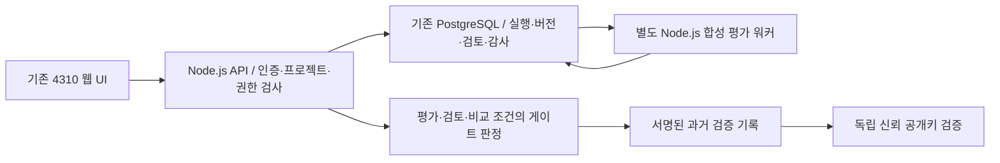
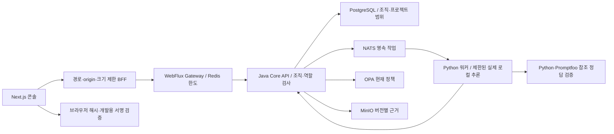

# AgentTrust 제출용 기술 개요

기업 개발팀이 에이전트 변경의 평가 근거를 확인하고 관리자 검토와 현재 정책을 거쳐 릴리스 여부를 판단하는 검토 시스템이다. 현재 제출 후보의 리비전별 상태는 [제출 후보](portfolio-submission.md)를 따른다. 이 문서는 기존 구현을 설명하며 상용 운영 수용이나 신규 기능 완료를 주장하지 않는다.

## 최종 제출 제품 4310의 요청과 근거 흐름

4310은 기존 JavaScript 제품이다. 정적 화면 `apps/web` → Node.js API `apps/api` → 기존 PostgreSQL 및 별도 Node.js 워커 `apps/worker`의 경로를 사용한다. Next.js·Java·Python·NATS·MinIO 경로와 혼합해 소개하지 않는다.

4310의 평가 조회·근거·검토 이력·최종 게이트·과거 기록을 시연한다. 상용 운영과 실제 모델 추론을 완료했다고 주장하지 않는다. 현재 게이트 판정과 과거 검증 기록의 유효 의미를 구분한다. 아래 새 스택의 구현·설계 표는 별도 기술 전환 이력이며 현재 제출 UI의 아키텍처가 아니다.

## 보존 이력: 새 스택 요청과 근거 흐름

다이어그램은 요청·작업·검증 관계를 나타낸다. 화면에서 Object Storage나 데이터베이스로 직접 접근한다는 뜻이 아니다. 원본 출력은 범용 수집·보관 기능이 아니며 현재 참조 정답 경로와 출력 제한은 [실제 평가 범위](stack-reference-evaluation.md)를 따른다.

## 설명할 설계 선택과 실제 코드

| 선택 | 구현 이유와 비용 | 확인할 코드 |
|---|---|---|
| 브라우저 입력을 그대로 upstream에 전달하지 않음 | 경로·origin·쿠키·응답 크기를 제한한다. 배포 origin 변경은 별도 계약 검증이 필요하다 | [BFF](../apps/console/src/app/backend/[...path]/route.ts), [Gateway](../services/gateway/src/main/java/dev/agenttrust/gateway/GatewayController.java) |
| 평가 통과와 릴리스 허용 분리 | 평가가 통과해도 검토·정책·근거 조건이 부족하면 허용하지 않는다 | [판정 표시](../apps/console/src/components/DecisionSummary.tsx), [다음 행동](../apps/console/src/lib/release-presentation.ts), [OPA](../services/opa/policies/release.rego) |
| 요청 키로 불확실한 쓰기 결과 조회 | 응답 유실 시 무조건 새 실행을 만들지 않는다. 요청 키·사용자·조직·프로젝트 결합이 필요하다 | [RunService](../services/core-api/src/main/java/dev/agenttrust/core/RunService.java), [요청 복구 검사](../services/core-api/src/test/java/dev/agenttrust/core/CampaignRequestResolutionTest.java) |
| 고정된 참조 정답과 실행 프로필 | 재현 가능한 작은 평가 범위를 제공한다. 범용 품질·안전성 점수로 일반화할 수 없다 | [참조 워커](../services/ai-worker/quality_worker.py), [평가기](../services/ai-worker/quality_evaluator.py) |
| 과거 서명과 현재 권한 분리 | 과거 기록은 현재 반려 후에도 진위를 확인할 수 있다. 실제 릴리스 직전에는 현재 게이트를 다시 확인한다 | [과거 판정 기록](../services/core-api/src/main/java/dev/agenttrust/core/CampaignReceipts.java), [서명 계약 검사](../services/core-api/src/test/java/dev/agenttrust/core/CampaignReceiptsTest.java) |
| 실패한 조회에서 이전 근거 제거 | 다른 평가의 허용 결과가 남는 오판을 방지한다 | [Workspace](../apps/console/src/components/Workspace.tsx), [ID 조회 브라우저 시나리오](../apps/console/e2e/evaluation-id-lookup.spec.ts) |

코드와 테스트의 존재 확인은 최신 전체 테스트 재실행을 뜻하지 않는다. 현재 증거의 리비전과 검증 환경은 제출 후보 문서에서 별도로 확인한다.

## 면접에서 구분해 설명할 한계

- 합성 판정과 실제 로컬 모델 추론은 다른 경로다. 실제 유료 공급자 계정 연동 완료를 주장하지 않는다.
- 규칙 특징 이웃 검색은 AI 의미 검색이 아니다. 현재 페이지 필터를 전체 이력 검색으로 소개하지 않는다.
- 최신 500개 감사 메타데이터 내보내기는 전체 감사 이력이나 독립 감사 서명이 아니다.
- 개발용 과거 판정 서명, 공급망 이미지/SBOM 서명, 현재 게이트의 권한은 서로 다르다.
- Helm/Terraform 렌더·검증은 실제 클러스터 설치·HA·운영 SLA가 아니다.
- PR10/11 원격 성공은 현재 로컬 적용을 뜻하지 않는다. 확대·Narrator·사용자 과업과 최종 로컬 수용은 아직 미완료다.
