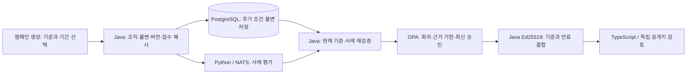

# 비교 기준에 묶인 캠페인 게이트

2026-10-12 로컬 실제 서비스에서 검증한 계약이다. 이 변경의 GitHub CI와 게시 이미지 검증은 별도 실행 결과로 확인한다.

기업 개발팀이 캠페인을 생성할 때 `baselineCampaignId`와 `evidenceMaxAgeSeconds`를 함께 지정한다. 기준은 같은 조직·프로젝트, 같은 에이전트 이름, 정확히 같은 데이터셋 버전·해시에 속해야 한다. 기준 캠페인의 실행이 끝난 뒤에만 새 캠페인을 접수한다. 필수 사례의 오류·미확인 결과는 접수 자체에서 숨기지 않고 현재 게이트의 판정 보류 근거로 남긴다.

두 값은 별도 불변 테이블에 생성 요청과 함께 저장하며 멱등 요청 해시에 포함한다. 이후 기준을 바꾸는 API는 제공하지 않는다. 기존 캠페인의 응답과 MinIO 보관 바이트를 변경하지 않는다. 기존 캠페인은 기존 정책 계약을 유지하고, 기준을 지정한 캠페인에만 추가 조건이 적용된다.

Java가 현재 캠페인과 기준의 불변 버전 및 사례를 재검증한다. OPA는 현재 평가·최신 관리자 검토와 함께 회귀 비교와 양쪽 평가 근거의 유효 기간을 판정한다. 필수 회귀는 차단, 미확인 비교·오류·근거 만료는 판정 보류다. 관리자 승인은 이러한 조건을 덮어쓸 수 없다. 유효 기간은 생성 시각부터 60~86,400초로 제한한다. 미래 시각과 정확한 만료 경계는 허용하지 않는다.

현재 서명 확인은 기준과 유효 기간을 서명에 묶고, 허용된 응답의 만료 시각을 양쪽 근거의 만료 시각 이하로 제한해야 한다. 기존 과거 서명의 검증 계약은 보존한다. 서명 확인은 개발용 검토 증거이며 실제 배포 권한이나 운영 준비 증명이 아니다.

검증 범위는 Java/Rego/TypeScript 계약 검사, 실제 Python/NATS 캠페인 실행, 조직 경계·멱등성·기준 치환 거부, 승인으로 오류·만료를 우회할 수 없는 조건, 보관 해시와 공개키 서명 검증 및 화면 흐름이다. 기존 업무 데이터·설정·LogiTrack 자산과 디스크 여유를 별도로 확인한다.

## 실제 검증 결과

Java 94개, Rego 20개, WebFlux 경로 22개, TypeScript 74개 검사와 정적 보고서 4개 검사가 통과했다. `python scripts/stack-baseline-gate-smoke.py`는 실제 OIDC→Next.js→WebFlux→Java→Python/NATS→OPA/MinIO 경로에서 6개 검증 묶음을 통과했다. 60초가 자연 경과하면 새 관리자 승인도 만료된 근거를 허용하지 못했다. 허용된 현재 서명은 기준 근거 만료 시각을 넘지 않았으며, 만료 후의 과거 서명과 부모·자식 바이트는 오프라인에서 검증됐다.

실제 브라우저에서는 조회자의 고정 조건·v2 서명 확인·다른 프로젝트 응답 거절·390px 너비와, 관리자의 기준 선택→생성→Python 완료→승인→현재 서명 확인이 각각 통과했다. API 역할의 UPDATE/DELETE 권한은 없고, 조직 범위 없이 새 조건을 읽을 수 없었다. V15는 새 빈 테이블과 Flyway 기록만 추가했다. 창 시작 이전 새 스택 업무 테이블 14개의 전체 행 해시와 기존 JavaScript 업무 테이블 11개·감사 기록 67,911개의 바이트가 보존됐다.

## 범위와 검토 절차

`GET /api/campaigns/{id}/release-requirements`는 인증된 읽기 전용 조건 조회다. 캠페인 생성 본문에 두 추가 값을 생략하면 기존 계약을 사용한다. 지정한 경우 요청 해시는 기준과 기간을 포함하며, 조회 시 저장된 조건과 접수 해시의 일치도 확인한다. 기존 캠페인 API와 MinIO 문서 구조는 유지한다.

새 조건에 묶인 현재 확인과 과거 판정 payload는 schema v2다. 기존 schema v1 검증을 유지한다. v2에는 불변 기준, 같은 데이터셋 해시, 양쪽 생성 시각·기한과 당시 비교 결과를 서명한다. 브라우저와 독립 공개키 CLI는 이 값의 범위·시간·판정 모순을 거부한다. 과거 HTML에는 기준과 당시 비교도 표시한다.

Java JSON 역직렬화는 소수를 정수로 잘라서 받지 않는다. 기간의 소수·문자열·불리언은 실제 API에서 거부한다. 동일한 설정은 정수로 정의된 버전 번호에도 적용한다.

`python scripts/stack-baseline-unresolved-smoke.py`는 자체 생성한 기준 평가를 실제 작업자 중단 중 취소한 뒤 작업자를 복구한다. 후속 Python 평가가 성공하고 관리자가 승인해도 취소된 기준은 판정 보류로 유지됐다. 취소 결과는 품질 특징 추출 대상에서 제외하고, 개별 특징 추출 오류도 후속 정상 색인을 막지 않게 했다. 같은 검사는 후속 평가의 실제 Python 특징과 pgvector 검색 성공까지 확인한다. 기존 취소 결과는 변경하지 않는다.

현재 번들은 후보 캠페인의 부모·자식 보관 바이트를 포함한다. 비교 기준 캠페인의 별도 MinIO 바이트까지 포함하는 대량 증거 번들은 아직 구현하지 않았다. 기준 ID와 비교 조건은 Java 서명으로 검증하며, 기준의 별도 바이트까지 오프라인에서 검증했다고 주장하지 않는다. 근거 만료는 캠페인 생성 시각 기준이며 버전 자체의 폐기·운영 유효 기간이나 동적 회귀 임계값을 이전한 것은 아니다.

