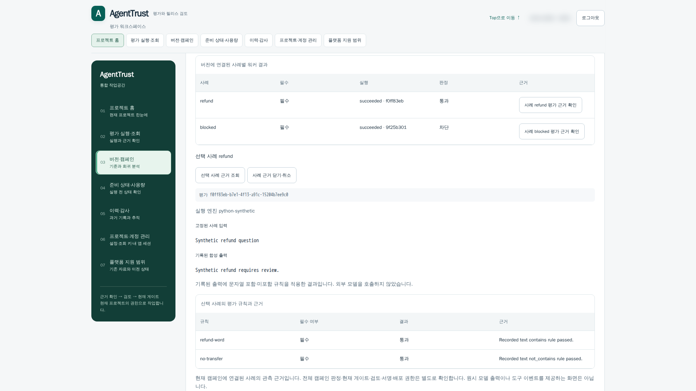

# AgentTrust 실제 제품 시연 — 2026-11-15

**실제 제품 화면의 4분 영상·한국어 자막·화면 캡처·공개 점검을 완료했다.** 격리된 합성 후보에서 직접 등록·실행·조회·다운로드한 화면이다. 문서·도식 설명 영상이나 가짜 API 응답 화면으로 대체하지 않았다. 기존 복구 4320 적용·운영 배포와는 별도다.

[4분 시연 영상 MP4](media/portfolio-20261115/agenttrust-demo-ko.mp4) · [한국어 SRT](media/portfolio-20261115/agenttrust-demo-ko.srt) · [편집용 ASS](media/portfolio-20261115/agenttrust-demo-ko.ass) · [파일 SHA-256 목록](media/portfolio-20261115/release-manifest.json) · [공개 점검 결과](media/portfolio-20261115/release-review.json)

## 영상과 실제 확인 결과

1920×1080, H.264, 25fps, 정확히 240초·6000프레임, 무음이다. 한국어 자막 24구간을 영상에 포함했다. SRT·ASS는 별도 편집용이며 MP4 재생 시 외부 자막을 추가 적용할 필요가 없다.

| 구간 | 실제 제품에서 수행한 행동 |
|---|---|
| 00:00~00:20 | 로그인 후 작업공간·프로젝트 홈 확인. 로그인·비밀번호 입력 장면은 촬영에서 제외 |
| 00:20~00:48 | 기록된 문자열 규칙 예제 초안 준비·내용 확인 |
| 00:48~01:22 | 에이전트와 데이터셋 각각 명시 등록. 실제 응답의 계약·해시 확인 |
| 01:22~01:50 | 통합 카탈로그 조회·등록 데이터셋 선택·고정 정의 펼치기 |
| 01:50~02:23 | 등록 버전 선택·실제 캠페인 생성. 실제 Python 완료의 pass/block 확인 |
| 02:23~03:12 | 캠페인 판정과 통과·차단 사례의 규칙 ID·필수 여부·상태·이유 확인 |
| 03:12~03:38 | 자식 평가 ID로 근거 열기·실제 관측 JSON 다운로드 |
| 03:38~04:00 | 과거 관측과 현재 게이트·배포 권한의 차이, 후속 범위 설명 |

브라우저가 확인한 캠페인 ID의 SHA-256과 실제 PostgreSQL의 동일 캠페인을 대조했다. 새 후보 DB에는 에이전트 1개·데이터셋 1개·캠페인 1개·사례 2개가 있으며, 두 사례는 `succeeded/pass`, `succeeded/block`, 실행 엔진은 `python-synthetic`이었다. provider 예약 0건·검토 0건·서명 관측 발급 0건도 읽기 전용으로 확인했다.

실제 다운로드 1057바이트의 kind·평가 ID 결합, `historicalEvidenceOnly=true`, `deploymentAuthority=false`, `signed=false`, `currentGateIncluded=false`를 검증하고 SHA-256을 보존했다. 원시 다운로드 응답·자격증명·쿠키·트레이스는 제출 파일에 넣지 않았다.

근거: [실제 DB·이미지·구성 대조](media/portfolio-20261115/backend-verification.json), [촬영 시점·다운로드 지문](media/portfolio-20261115/capture-proof.json), [영상 형식·전체 디코딩](media/portfolio-20261115/media-verification.json).

## 소스와 수용 범위

촬영 소스는 수용된 `23c810c769a59477308d3fd3df7aba39c2487bb4`의 Git archive에 [의존성 보안 수정](stack-capture-dependency-fix-20261115.md)의 lockfile과 그에 따른 quality 프로필 4개 갱신을 적용한 구성이다. 정확한 수정 커밋과 오버레이 파일 SHA-256은 검증 JSON에 기록했다. 현재 개발 브랜치의 미수용 15번째 기능과 보존 중인 worker 한 줄 변경은 촬영 소스에 넣지 않았다.

[수용된 14개 기능의 소개·정확 SHA·CI 근거](stack-portfolio-accepted14.md)는 그대로 구분한다. 이번 영상은 대표 흐름의 실제 재현이며 14개 기능 전부의 새로운 CI 수용이나 현재 HEAD 전체의 통합 수용을 뜻하지 않는다. 고정 시나리오 예제와 기록 문자열 규칙 예제도 다른 계약이다.

## 보안 수정·격리

Promptfoo `0.124.1`과 기존 high 차단 기준을 유지했다. 호환 범위의 전이 의존성 14개 버전을 갱신한 뒤 `npm ci`, Node 18검사, Linux verifier의 검사·동일 high 감사·이미지 빌드가 통과했다. 촬영 후보의 Python 이미지 검사 110개도 통과했다. 확인 시 npm high 0·critical 0이며 **moderate 8개는 남아 있다**. 전체 소프트웨어 취약점 0이나 운영 보안 수용으로 표시하지 않는다. [감사 요약](media/portfolio-20261115/security-verification.json)을 따른다.

새 촬영 WSL·Docker 저장소·socket·합성 DB·계정·개발용 키를 사용했다. 기존 WSL의 방화벽 규칙을 변경하지 않고 촬영 엔진 자체를 별도 네트워크 네임스페이스 안에서 실행했다. 제품 서비스의 호스트 포트 게시 0건, 11개 실제 컨테이너의 이미지 ID·시작 시각·전용 볼륨·작업 경로·순서 있는 Compose 파일을 대조했다. 보안 가드나 감사 기준을 끄지 않았다.

## 공개 점검

- 실제 주요 화면 9장을 시각 검토하고 계정·조직 표시 마스킹을 확인했다. 보이는 평가·캠페인 식별자는 이번 새 합성 후보에서 생성된 값이다.
- 로그인·비밀번호 입력은 별도 비녹화 단계에서 수행했다. 녹화는 웹 페이지 영역만 포함하며 데스크톱·개발자 도구·다른 앱·음성은 포함하지 않는다.
- 자막 시점·구간 연속성·표시 내용을 촬영 이벤트와 대조했다. 제품 화면 전체를 자막 안전 영역 안에 배치해 표·버튼을 가리지 않도록 했다. 결과 내용 교체·재생 속도 변경은 없다. 마지막 정지 구간 일부만 잘라 240초로 맞췄다.
- 최종 6000프레임 전체 디코딩을 통과했다. 1초 간격과 장면 변화로 추출한 276프레임 및 주요 화면 9장에 한·영 OCR 패턴 검사를 수행했고 비밀번호·Bearer/provider 토큰·개인키·이메일 패턴 발견은 0건이었다. OCR 원문은 저장하지 않았다.
- PNG 형식·크기·불필요한 메타데이터와 최종 파일 크기·해시·ZIP 무결성을 확인했다. 저장소의 public 상태를 확인했으며 가시성·공유 설정은 변경하지 않았다.

OCR·시각 표본 검토는 모든 순간의 정보 부재를 증명하는 검사가 아니다. 그 한계를 남기면서 합성 데이터만 사용하는 촬영 경로, 로그인 제외, 마스킹, 파일 목록과 검토 범위를 함께 확인했다. 과거 4310 영상·접근성 미완료를 이번 4320 영상으로 완료 처리하지 않는다.

## 촬영 후 정리와 후속 범위

촬영 편집자 세션 0건과 관리자 세션 종료를 확인했다. 최종 영상·자막·검증 기록을 Windows 출력 폴더에 보존한 뒤 새로 만든 촬영 WSL만 제거했고 디스크 여유를 회복했다. 기존 복구 WSL·서비스·원본·R/T 연결·기존 프록시를 변경하지 않았다. [정리 기록](media/portfolio-20261115/cleanup-report.json)을 따른다.

15번째 기능, 전체 JSON Schema·도구 실행·관리자 정책·프로젝트/구성원 확장, 운영 배포와 운영 안정성 수용은 후속 범위다. 미검증 worker 한 줄은 커밋하지 않았다. 이번 촬영을 위해 새 CI를 실행하거나 기존 성공 CI를 반복하지 않았다.
